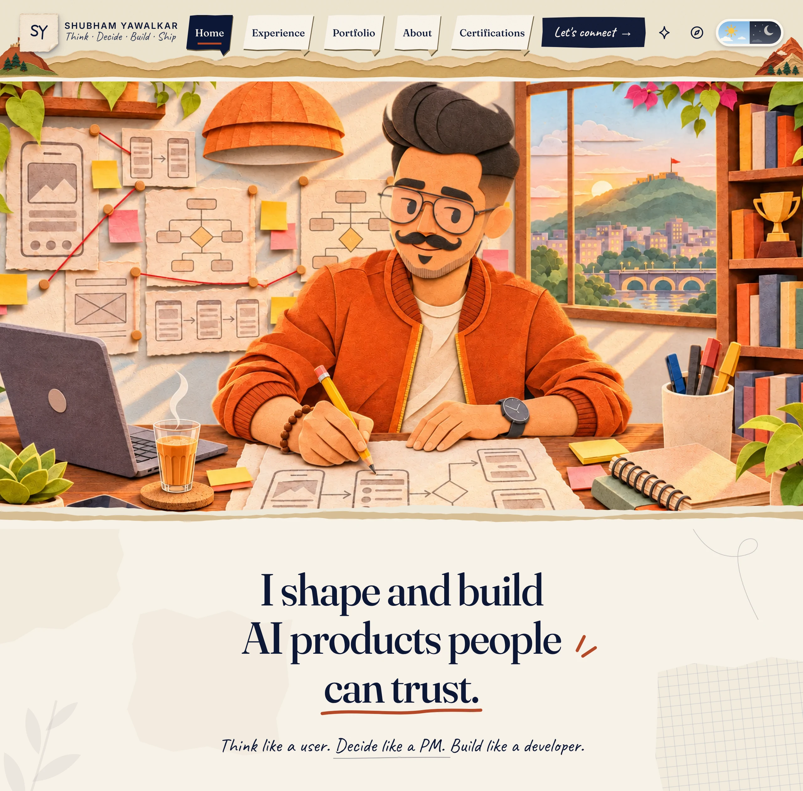
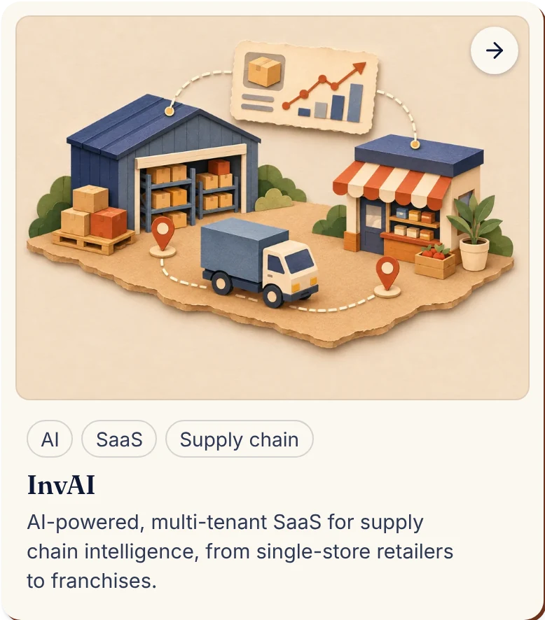
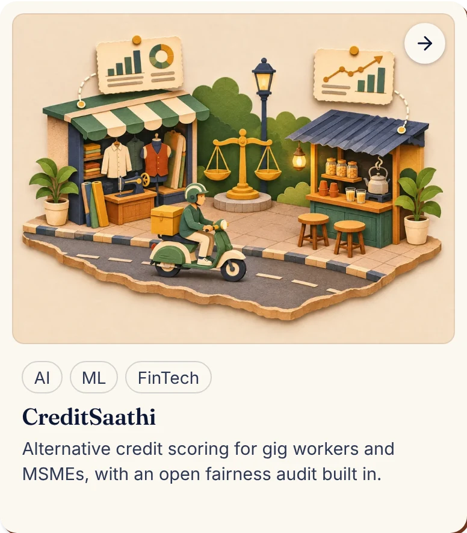
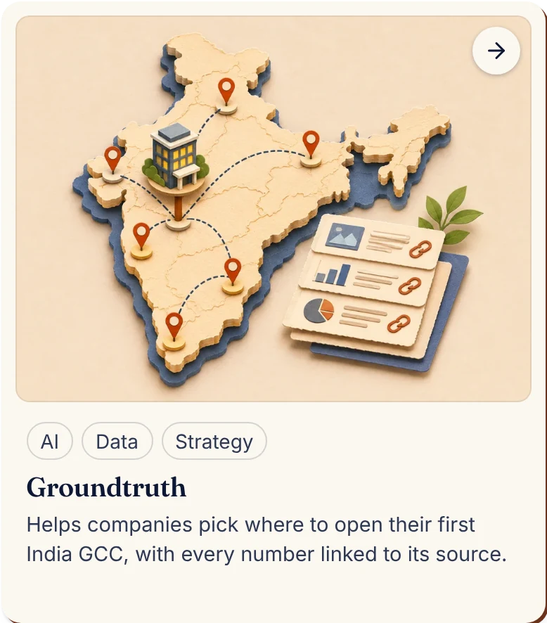
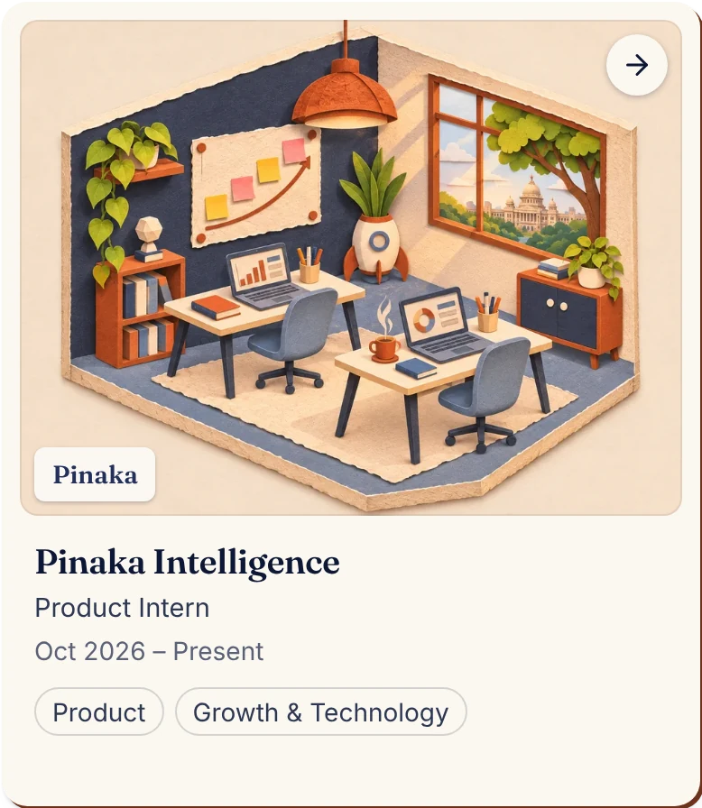
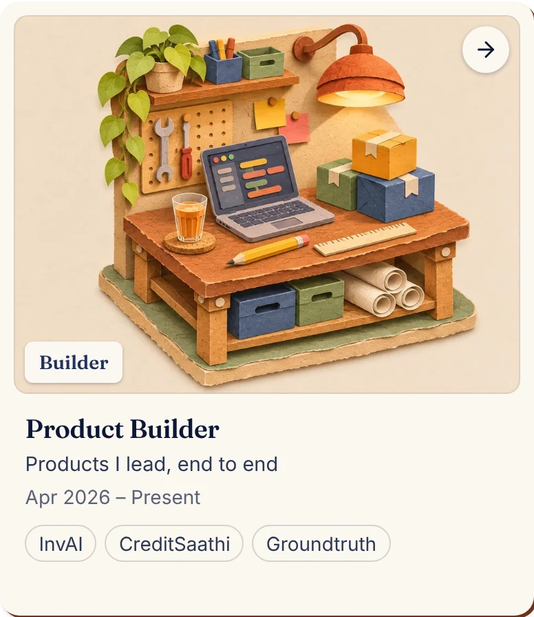
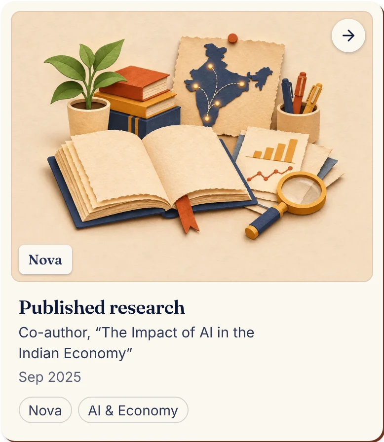

<a href="https://shubhamyawalkar.vercel.app">
  <picture>
    <source media="(prefers-color-scheme: dark)" srcset="./readme-assets/header-dark.webp" />
    
  </picture>
</a>

  <a href="https://shubhamyawalkar.vercel.app"><picture><source media="(prefers-color-scheme: dark)" srcset="./readme-assets/btn-site-dark.webp" /></picture></a>
  <a href="https://www.linkedin.com/in/shubham-yawalkar"><picture><source media="(prefers-color-scheme: dark)" srcset="./readme-assets/btn-linkedin-dark.webp" /></picture></a>
  <a href="mailto:work.shubhamyawalkar@gmail.com"><picture><source media="(prefers-color-scheme: dark)" srcset="./readme-assets/btn-email-dark.webp" /></picture></a>
  <a href="https://shubhamyawalkar.vercel.app/Shubham-Yawalkar-AIPM-Resume.pdf"><picture><source media="(prefers-color-scheme: dark)" srcset="./readme-assets/btn-resume-dark.webp" /></picture></a>

 

<picture>
  <source media="(prefers-color-scheme: dark)" srcset="./readme-assets/head-work-dark.webp" />
  
</picture>

  <a href="https://shubhamyawalkar.vercel.app/projects?product=invai"><picture><source media="(prefers-color-scheme: dark)" srcset="./readme-assets/work-1-dark.webp" /></picture></a>
  <a href="https://shubhamyawalkar.vercel.app/projects?product=creditsaathi"><picture><source media="(prefers-color-scheme: dark)" srcset="./readme-assets/work-2-dark.webp" /></picture></a>
  <a href="https://shubhamyawalkar.vercel.app/projects?product=groundtruth"><picture><source media="(prefers-color-scheme: dark)" srcset="./readme-assets/work-3-dark.webp" /></picture></a>

 

<picture>
  <source media="(prefers-color-scheme: dark)" srcset="./readme-assets/head-cred-dark.webp" />
  
</picture>

  <a href="https://shubhamyawalkar.vercel.app/work"><picture><source media="(prefers-color-scheme: dark)" srcset="./readme-assets/cred-1-dark.webp" /></picture></a>
  <a href="https://shubhamyawalkar.vercel.app/projects"><picture><source media="(prefers-color-scheme: dark)" srcset="./readme-assets/cred-2-dark.webp" /></picture></a>
  <a href="https://shubhamyawalkar.vercel.app/about#research"><picture><source media="(prefers-color-scheme: dark)" srcset="./readme-assets/cred-3-dark.webp" /></picture></a>

 

  <picture>
    <source media="(prefers-color-scheme: dark)" srcset="./readme-assets/stack-dark.webp" />
    
  </picture>

<picture>
  <source media="(prefers-color-scheme: dark)" srcset="./readme-assets/footer-dark.svg" />
  
</picture>
