  <a href="https://shubhamyawalkar.vercel.app"><b>Visit the live site</b></a>
  &nbsp;&nbsp;|&nbsp;&nbsp;
  <a href="https://linkedin.com/in/shubham-yawalkar">LinkedIn</a>
  &nbsp;&nbsp;|&nbsp;&nbsp;
  <a href="mailto:shubham.yawalkar@adypu.edu.in">Email</a>

My personal portfolio as an aspiring AI Product Manager and full stack developer, covering my projects InvAI and CreditSaathi, my skills, published research and recognition.

---

© 2026 Shubham Yawalkar. All rights reserved. The design, code and content of this site may not be copied, reused or redistributed without permission.
