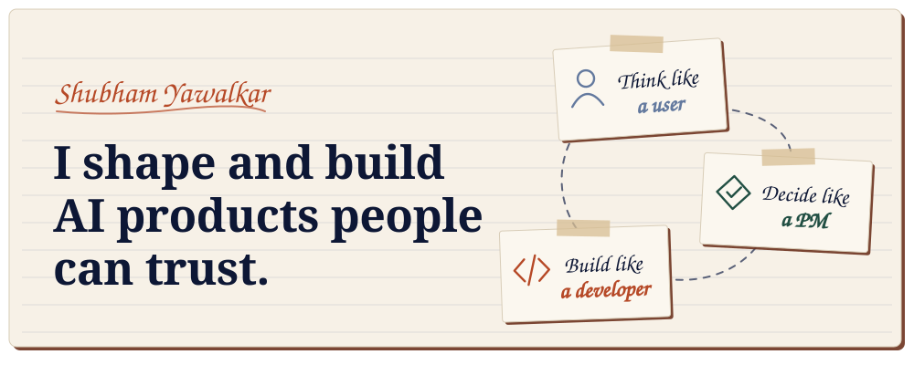
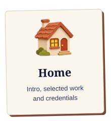
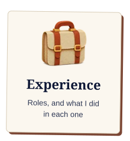
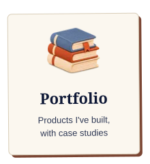
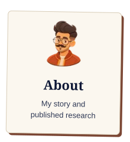
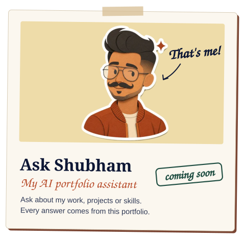
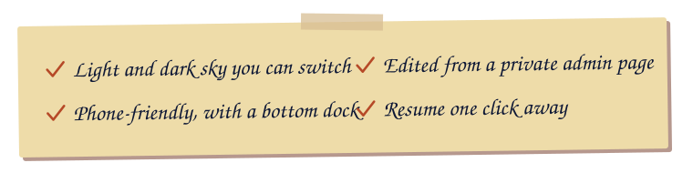
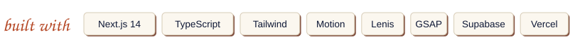
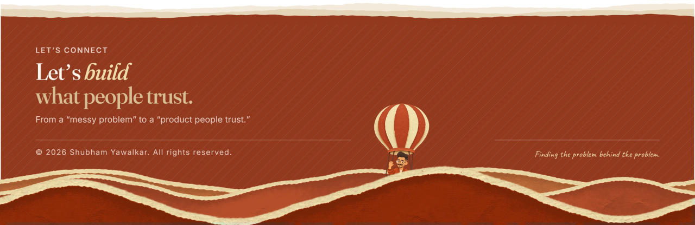

<a href="https://shubhamyawalkar.vercel.app"><picture><source media="(prefers-color-scheme: dark)" srcset="./readme-assets/header-dark.svg" /></picture></a>

  <a href="https://shubhamyawalkar.vercel.app"><picture><source media="(prefers-color-scheme: dark)" srcset="./readme-assets/btn-site-dark.svg" /></picture></a>
  <a href="https://www.linkedin.com/in/shubham-yawalkar"><picture><source media="(prefers-color-scheme: dark)" srcset="./readme-assets/btn-linkedin-dark.svg" /></picture></a>
  <a href="mailto:work.shubhamyawalkar@gmail.com"><picture><source media="(prefers-color-scheme: dark)" srcset="./readme-assets/btn-email-dark.svg" /></picture></a>
  <a href="https://shubhamyawalkar.vercel.app/Shubham-Yawalkar-AIPM-Resume.pdf"><picture><source media="(prefers-color-scheme: dark)" srcset="./readme-assets/btn-resume-dark.svg" /></picture></a>

 

<picture><source media="(prefers-color-scheme: dark)" srcset="./readme-assets/head-pages-dark.svg" /></picture>

  <a href="https://shubhamyawalkar.vercel.app/"><picture><source media="(prefers-color-scheme: dark)" srcset="./readme-assets/page-home-dark.svg" /></picture></a>
  <a href="https://shubhamyawalkar.vercel.app/work"><picture><source media="(prefers-color-scheme: dark)" srcset="./readme-assets/page-experience-dark.svg" /></picture></a>
  <a href="https://shubhamyawalkar.vercel.app/projects"><picture><source media="(prefers-color-scheme: dark)" srcset="./readme-assets/page-portfolio-dark.svg" /></picture></a>
  <a href="https://shubhamyawalkar.vercel.app/about"><picture><source media="(prefers-color-scheme: dark)" srcset="./readme-assets/page-about-dark.svg" /></picture></a>
  <a href="https://shubhamyawalkar.vercel.app/certifications"><picture><source media="(prefers-color-scheme: dark)" srcset="./readme-assets/page-certs-dark.svg" /></picture></a>

 

<picture><source media="(prefers-color-scheme: dark)" srcset="./readme-assets/head-features-dark.svg" /></picture>

  <a href="https://shubhamyawalkar.vercel.app"><picture><source media="(prefers-color-scheme: dark)" srcset="./readme-assets/feat-tour-dark.svg" /></picture></a>
  <a href="https://shubhamyawalkar.vercel.app/#ask"><picture><source media="(prefers-color-scheme: dark)" srcset="./readme-assets/feat-ask-dark.svg" /></picture></a>

  <picture><source media="(prefers-color-scheme: dark)" srcset="./readme-assets/extras-dark.svg" /></picture>

 

  <picture><source media="(prefers-color-scheme: dark)" srcset="./readme-assets/stack-dark.svg" /></picture>

<picture><source media="(prefers-color-scheme: dark)" srcset="./readme-assets/footer-dark.svg" /></picture>
